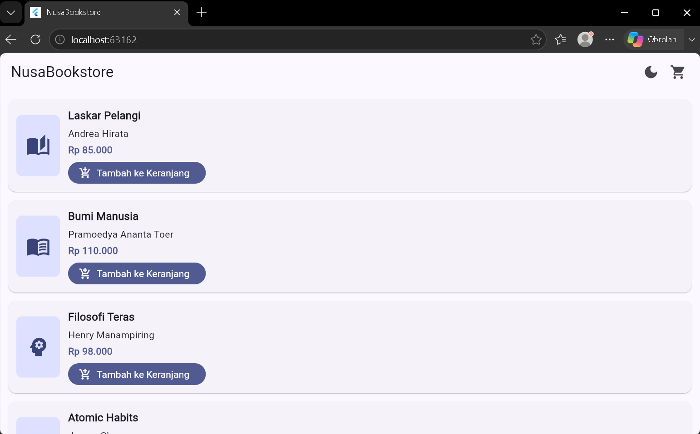
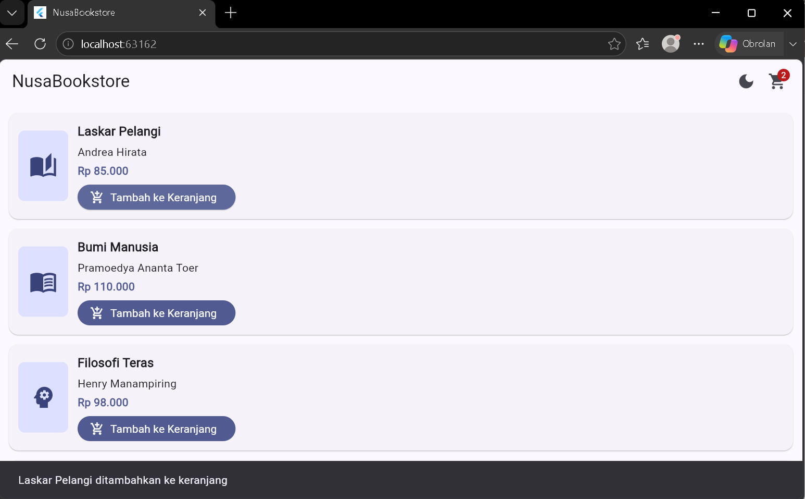
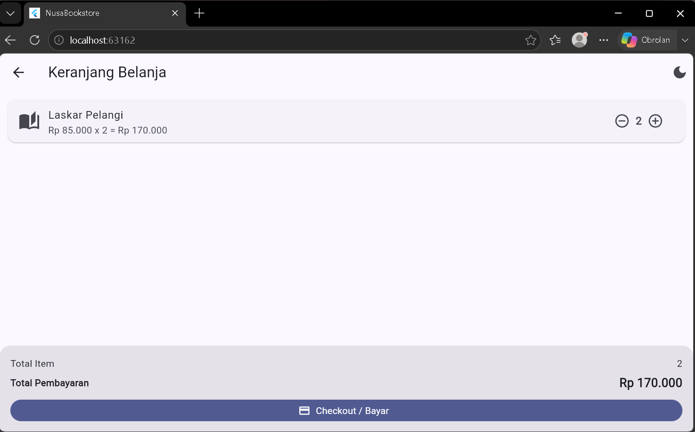
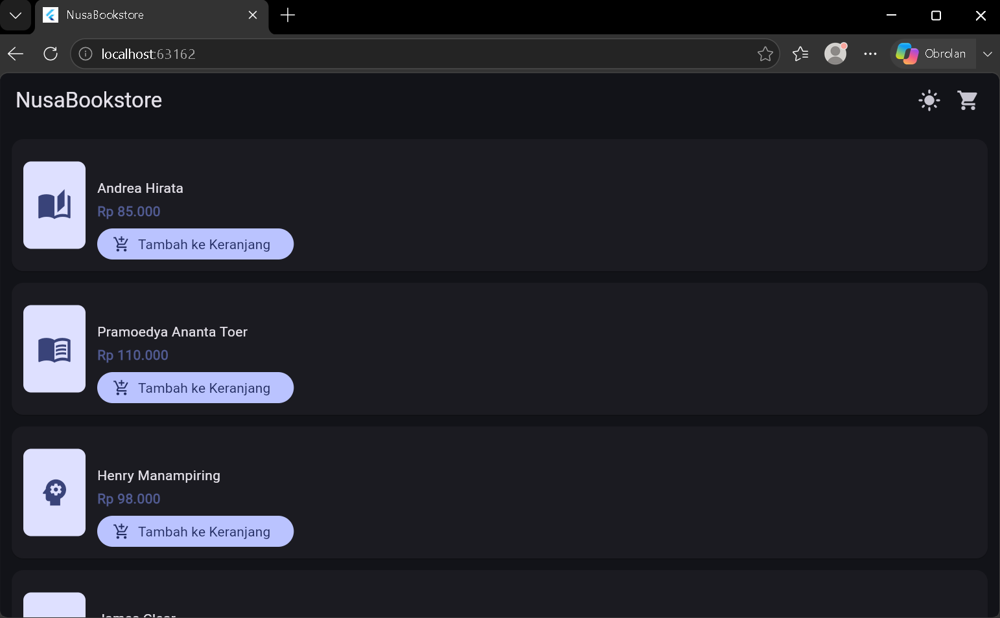
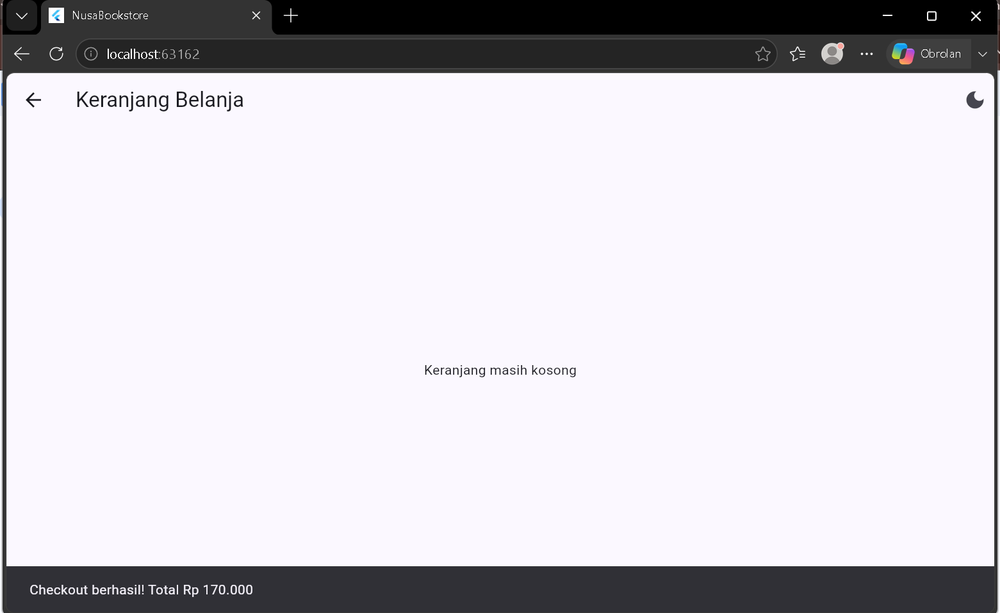

# NusaBookstore

Aplikasi toko buku sederhana dengan **Flutter** dan **State Management Provider**
(`CartProvider`, `ThemeProvider`, `MultiProvider`).

## Fitur
- Katalog buku (5 buku) dengan tombol **Tambah ke Keranjang**
- Badge jumlah item pada ikon keranjang (update otomatis)
- Halaman keranjang: tombol **-** / **+**, Total Item, Total Pembayaran (Rupiah)
- Checkout menampilkan SnackBar dan mengosongkan keranjang
- Light Mode / Dark Mode yang berlaku di seluruh aplikasi

## Cara Menjalankan
```bash
flutter pub get
flutter run
```

## Struktur Folder
```
lib/
├── models/
│   └── book.dart
├── providers/
│   ├── cart_provider.dart
│   └── theme_provider.dart
├── screens/
│   ├── catalog_screen.dart
│   └── cart_screen.dart
└── main.dart
```

## Screenshot

### Halaman Katalog (Light Mode)


### Badge Jumlah Keranjang
Badge bertambah setelah buku ditambahkan ke keranjang.



### Halaman Keranjang dengan Total Harga


### Dark Mode


### SnackBar Setelah Checkout
Keranjang kosong setelah checkout.


