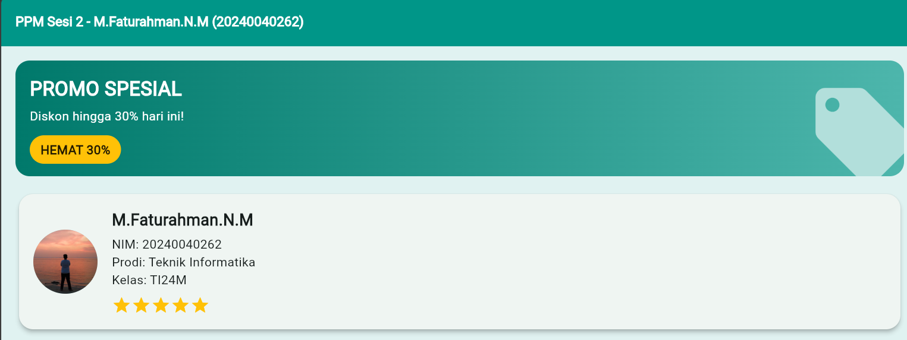
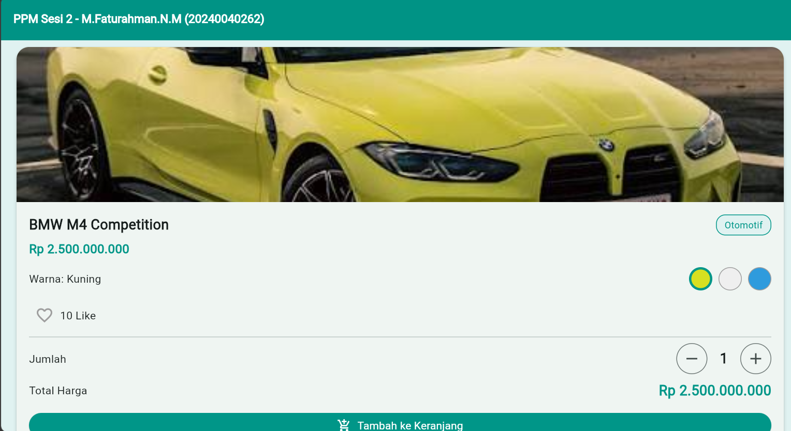
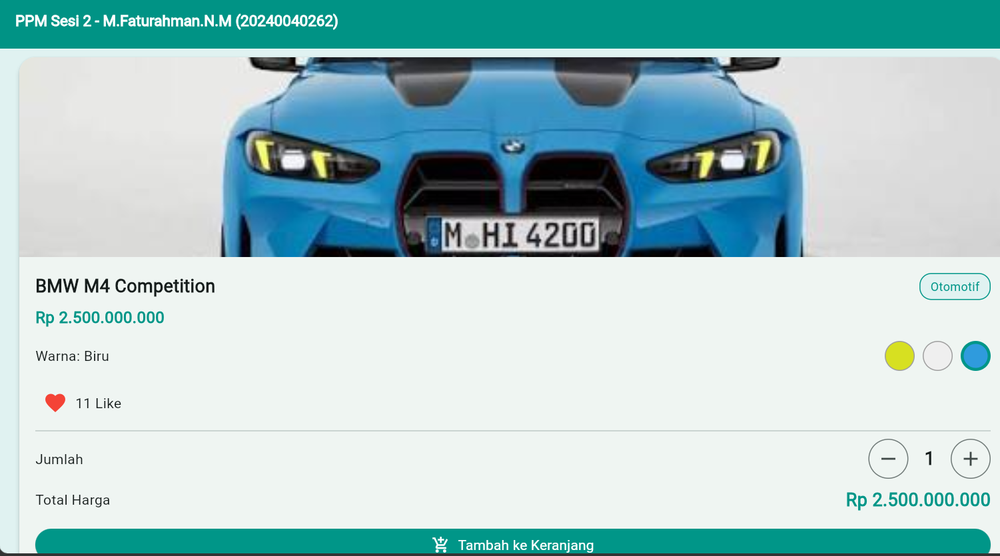
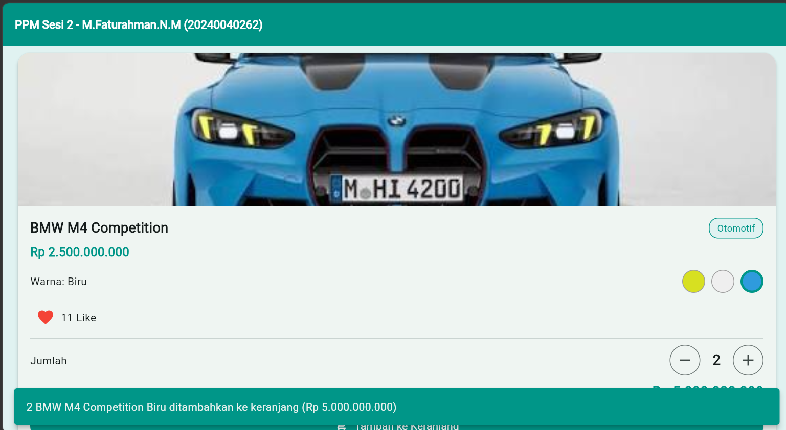

# PPM Sesi 2 - Dasar Flutter dan Widget

| | |
|---|---|
| **Nama** | M.Faturahman.N.M |
| **NIM** | 20240040262 |
| **Prodi** | Teknik Informatika |
| **Kelas** | TI24M |

## Deskripsi
Aplikasi Flutter sederhana berisi halaman **Product & Profile**:
- Banner promo (`Stack` + `Positioned`)
- Kartu profil mahasiswa (`StatelessWidget`) dengan foto, nama, NIM, prodi/kelas, dan 5 ikon bintang
- Kartu produk **BMW M4 Competition** (`StatefulWidget`) dengan:
  - Pilihan warna (kuning, putih, biru) yang mengganti gambar produk
  - Tombol Favorite (ikon hati berubah dan jumlah Like bertambah/berkurang)
  - Tombol `-` / `+` untuk jumlah produk (minimal 1) dan total harga yang berubah otomatis
  - Tombol **Tambah ke Keranjang** yang menampilkan SnackBar

## Widget yang Digunakan
Scaffold, AppBar, Row, Column, Container, Card, Stack, Positioned, Icon, ElevatedButton, IconButton, StatelessWidget, StatefulWidget.

## Struktur Project
```
ppm_sesi2_faturahman_20240040262/
├── assets/
│   └── images/
│       ├── profile.jpg          # foto profil mahasiswa
│       ├── kuning.jpg           # gambar produk warna kuning
│       ├── putih.jpg            # gambar produk warna putih
│       └── biru.jpg             # gambar produk warna biru
├── lib/
│   └── main.dart                # seluruh kode aplikasi
├── screenshots/
│   ├── 01-profil-banner.png
│   ├── 02-produk-kuning.png
│   ├── 03-produk-biru-favorite.png
│   └── 04-snackbar-keranjang.png
├── test/
│   └── widget_test.dart         # tes widget sederhana
├── android/ ios/ web/ ...       # folder platform bawaan Flutter
├── pubspec.yaml                 # konfigurasi dependency dan asset
└── README.md
```

### Penjelasan `lib/main.dart`
| Class | Jenis | Fungsi |
|---|---|---|
| `MyApp` | StatelessWidget | Root aplikasi dan tema (teal) |
| `HomePage` | StatelessWidget | Halaman utama (Scaffold + AppBar) |
| `PromoBanner` | StatelessWidget | Banner promo dengan Stack dan Positioned |
| `ProfileCard` | StatelessWidget | Kartu profil mahasiswa |
| `ProductCard` | StatefulWidget | Kartu produk (warna, Favorite, jumlah, total, keranjang) |

## Cara Menjalankan
```bash
flutter pub get
flutter run
```

## Screenshot

### Banner promo dan kartu profil


### Kartu produk (warna kuning)


### Ganti warna ke biru dan tombol Favorite aktif


### Jumlah 2 dan SnackBar setelah Tambah ke Keranjang
